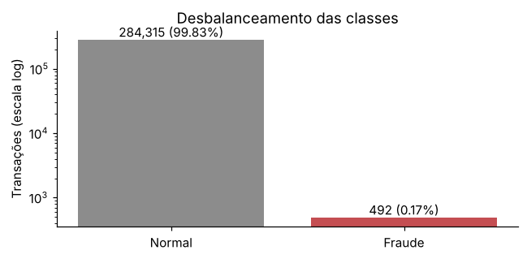
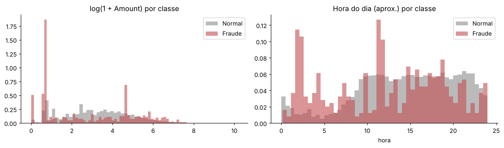
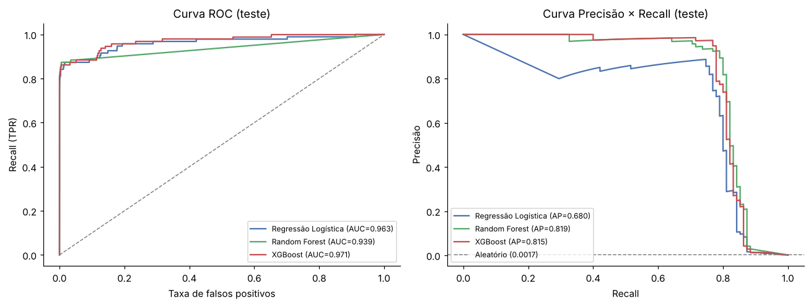
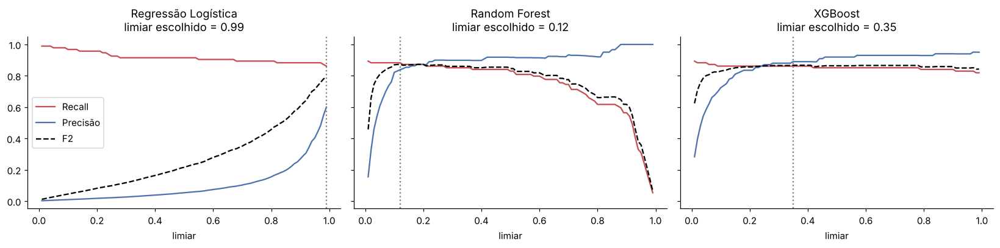
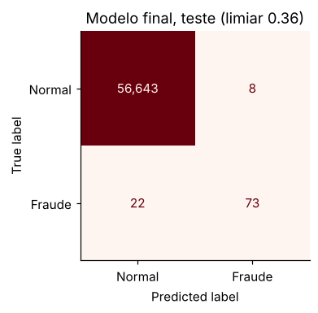
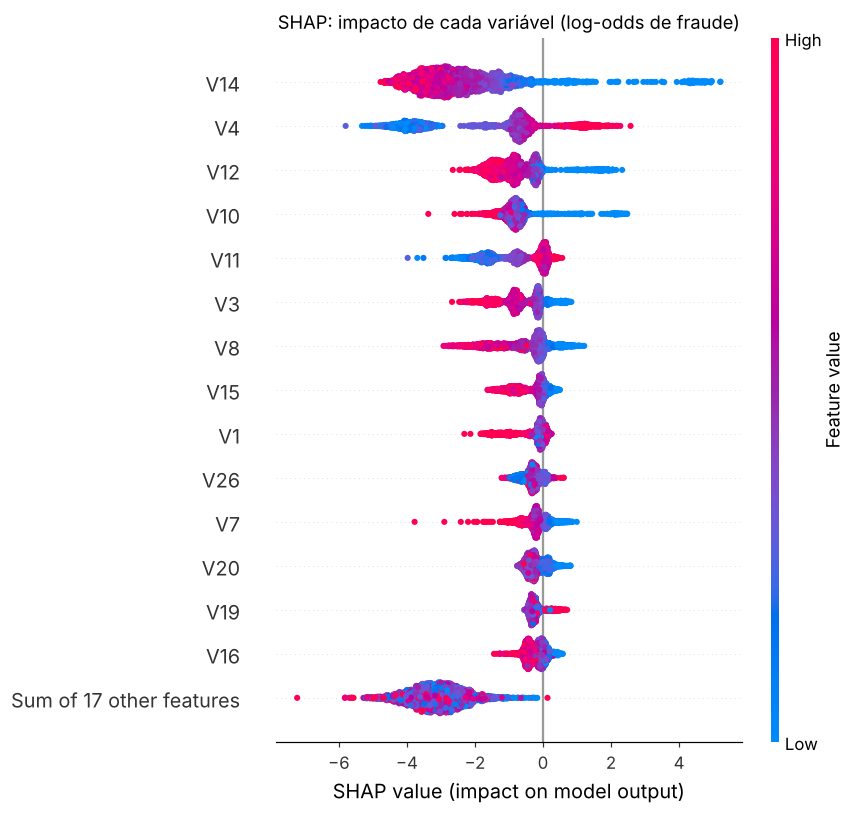
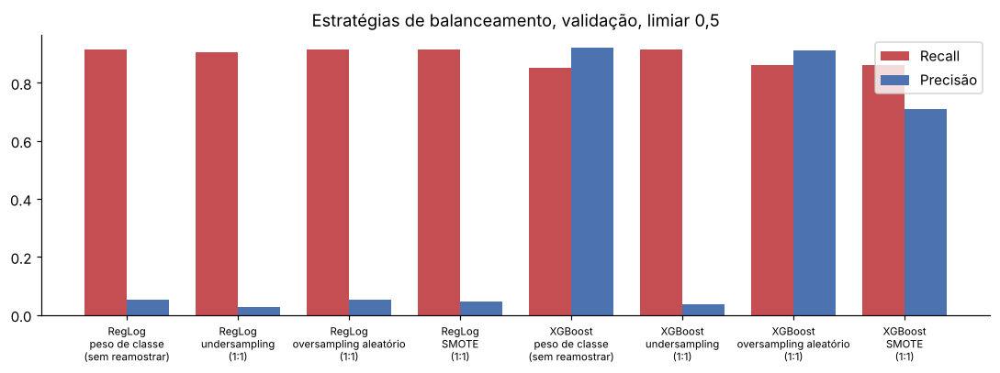

# Detecção de Fraude em Cartão de Crédito

Projeto do desafio da DIO: treinar e comparar modelos que detectam fraude em transações reais de cartão de crédito, onde **a fraude é rara e a acurácia engana**.

📓 **Notebook:** [`deteccao_fraude.ipynb`](deteccao_fraude.ipynb) (executado do início ao fim, com todas as saídas, tabelas e curvas salvas)

**Stack:** Python · pandas · NumPy · scikit-learn · XGBoost · imbalanced-learn · SHAP · Matplotlib

---

## 1. O problema e por que o desbalanceamento muda a avaliação

A base tem **284.807 transações** de cartões europeus (2 dias de setembro/2013), com só **492 fraudes (0,17%)**. As colunas `V1`–`V28` vêm de um PCA (anonimização), mais `Time`, `Amount` e `Class`.



Um modelo que responde **"não é fraude" para tudo** tem **99,83% de acurácia** e **0% de recall**: não pega nenhuma fraude. Por isso a avaliação foca na **classe fraude**:

| Métrica | O que mede |
|---|---|
| **Recall** (principal) | Das fraudes reais, quantas o modelo pegou |
| **Precisão** | Dos alertas, quantos eram fraude de verdade |
| **F1** | Equilíbrio entre os dois |
| **PR-AUC** | Qualidade do ranking de risco, independente do limiar |

Prova prática: no limiar padrão, a Regressão Logística tem **97% de acurácia** e dispara **1.591 falsos alarmes** para 95 fraudes.

## 2. Preparação dos dados

- **Duplicatas removidas** (1.081 linhas), para que a mesma transação não caia no treino e no teste ao mesmo tempo. Ficaram 473 fraudes.
- **`Amount_log = log1p(Amount)`**: o valor tem cauda muito longa (até € 25.691).
- **Hora do dia cíclica** (`hora_sin`, `hora_cos`) a partir de `Time`: as fraudes se concentram mais na madrugada. O `Time` bruto saiu, porque é só um relógio crescente de 2 dias.
- **Split estratificado em 3 partes:** treino 60% / validação 20% / teste 20%, todos com ~0,167% de fraude. O **limiar é escolhido na validação**; o teste só é usado na avaliação final.
- **StandardScaler** dentro do pipeline da Regressão Logística (ajustado só no treino). Os modelos de árvore usam os valores originais.



## 3. Comparação dos modelos

Todos tratam o desbalanceamento com **peso de classe** (`class_weight="balanced"` / `scale_pos_weight ≈ 598`).
Resultados no **conjunto de teste** (95 fraudes, 56.651 normais):

| Modelo | Limiar | Recall | Precisão | F1 | PR-AUC | Fraudes pegas | Falsos alarmes |
|---|---|---|---|---|---|---|---|
| Regressão Logística | 0,50 | **0,874** | 0,050 | 0,094 | 0,681 | 83/95 | 1.591 |
| Regressão Logística | 0,99 (ajustado) | 0,800 | 0,628 | 0,704 | 0,681 | 76/95 | 45 |
| Random Forest | 0,50 | 0,705 | 0,957 | 0,812 | 0,819 | 67/95 | 3 |
| Random Forest | 0,12 (ajustado) | **0,800** | 0,835 | 0,817 | 0,819 | 76/95 | 15 |
| XGBoost | 0,50 | 0,779 | 0,949 | **0,856** | 0,815 | 74/95 | 4 |
| XGBoost | 0,35 (ajustado) | 0,779 | 0,902 | 0,836 | 0,815 | 74/95 | 8 |
| **XGBoost + GridSearch (final)** | **0,36** | 0,768 | 0,901 | 0,830 | **0,821** | 73/95 | 8 |



A curva ROC faz os três parecerem ótimos (ROC-AUC de 0,94 a 0,97). A curva **Precisão × Recall** mostra a diferença real: a Regressão Logística fica muito atrás dos modelos de árvore.

## 4. Limiar de decisão e o que o SHAP mostrou

### Limiar

O `0,5` é arbitrário. O critério usado foi **maximizar o F2 na validação**: o F2 pesa o recall 2× mais que a precisão, coerente com o recall como métrica principal sem ignorar o custo de um alerta falso.



- **Regressão Logística:** o limiar subiu para 0,99 e os falsos alarmes caíram de 1.591 para 45.
- **Random Forest:** o limiar desceu para 0,12, pegando **9 fraudes a mais** (67 → 76) ao custo de 12 alertas a mais.
- **Modelo final (XGBoost GridSearch): limiar 0,36**, com 73/95 fraudes pegas e só 8 falsos alarmes entre 56.651 transações normais.

**Por que o XGBoost como final:** ele foi escolhido antes de olhar o teste, pelo melhor PR-AUC no CV (0,842) e pelo melhor equilíbrio na validação (86% recall / 90% precisão). No teste, o Random Forest ajustado pegou 3 fraudes a mais, mas com quase o dobro de falsos alarmes. Com 95 fraudes, essa diferença está dentro da variação esperada, e o RF fica documentado como alternativa se o negócio aceitar mais alertas.



### SHAP



- **V14, V4, V12 e V10** dominam a decisão. Valores **muito negativos de V14, V12 e V10** e **valores altos de V4** empurram para fraude, o mesmo padrão da correlação na EDA.
- `Amount_log` e a hora do dia pesam pouco: o sinal está quase todo nos componentes do PCA.
- **Fraude detectada** ([gráfico](images/11_shap_fraude_detectada.png)): todos os sinais fortes apontam na mesma direção → P(fraude) ≈ 1,0.
- **Fraude que escapou** ([gráfico](images/12_shap_fraude_perdida.png)): sinais contraditórios. V14 e V4 empurram para fraude, mas V11, V1 e V24 puxam mais forte para "normal" → P(fraude) ≈ 0,01. Nenhum limiar razoável a pegaria. Isso indica que a próxima melhoria vem de **dados novos**, não de outro algoritmo.

## 5. O que mudei em relação ao que a Expert fez

| Mudança | Por quê | Resultado |
|---|---|---|
| **Remoção de 1.081 duplicatas** | Evitar a mesma linha no treino e no teste | Métricas mais honestas |
| **Validação separada para o limiar** (60/20/20) | Escolher o limiar no teste é "olhar a prova" | Teste usado só no final |
| **Hora do dia cíclica** (sin/cos) | 23h e 0h ficam próximas | Feature nova a partir de `Time` |
| **Critério F2** para o limiar | Formaliza "recall primeiro, sem ignorar precisão" | Limiar por modelo, justificado |
| **Under × Over × SMOTE × peso de classe**, dentro de pipeline `imblearn` | A regra da Expert: testar | Ver tabela abaixo |
| **GridSearchCV ampliado** (16 combinações, scoring = PR-AUC) | Otimizar a métrica certa, não acurácia | Ganho pequeno de PR-AUC |
| **Random Forest com `TunedThresholdClassifierCV`** | Pipeline que já sai do `fit` com o limiar embutido | Limiar 0,111 aprendido por CV; recall 0,80 |
| **Variáveis de tempo** (`delta_t`, transações nos últimos 60 s, valor vs. média de 10 min) | Testar "transações em sequência" | Sem ganho: falta ID de cartão |
| **SHAP por transação** (acerto e erro) | Explicar também onde o modelo falha | Fraude perdida tem sinais contraditórios |

### Estratégias de balanceamento (validação, limiar 0,5)

| Modelo | Estratégia | Recall | Precisão | PR-AUC | Falsos alarmes |
|---|---|---|---|---|---|
| XGBoost | Peso de classe | 0,851 | 0,920 | 0,878 | 7 |
| XGBoost | Undersampling 1:1 | **0,915** | 0,037 | 0,647 | 2.218 |
| XGBoost | Oversampling 1:1 | 0,862 | 0,910 | **0,884** | 8 |
| XGBoost | SMOTE 1:1 | 0,862 | 0,711 | 0,861 | 33 |
| Reg. Logística | Peso de classe | 0,915 | 0,053 | 0,790 | 1.533 |
| Reg. Logística | Undersampling 1:1 | 0,904 | 0,026 | 0,469 | 3.149 |



**Leitura:** undersampling maximiza o recall, mas destrói a precisão. Oversampling empata com o peso de classe e leva o dobro do tempo. SMOTE ficou pior no XGBoost. **Peso de classe + ajuste de limiar** foi a combinação mais simples e eficiente.

## Como executar

```bash
git clone https://github.com/PRGHeitorAraujo/deteccao-fraude-cartao.git
cd deteccao-fraude-cartao
pip install -r requirements.txt
jupyter notebook deteccao_fraude.ipynb
```

O dataset é carregado direto pelo link (espelho público do TensorFlow para a [base do Kaggle](https://www.kaggle.com/datasets/mlg-ulb/creditcardfraud)) e **não fica no repositório**. Para usar uma cópia local, defina a variável de ambiente `CREDITCARD_CSV` com o caminho do arquivo.

Execução completa: ~10 min em CPU (o GridSearch e o Random Forest são as etapas mais longas).

## Estrutura

```
├── deteccao_fraude.ipynb   # notebook completo, executado
├── images/                 # gráficos gerados pelo notebook
├── requirements.txt
└── README.md
```

## Próximos passos

- Dados com **ID de cartão** para variáveis de comportamento reais (velocidade de compras, desvio do valor médio do cliente)
- Definir o limiar por **custo financeiro** (valor da fraude × custo de revisão) em vez de F2
- Calibrar as probabilidades do modelo

---

Heitor Araujo · [GitHub](https://github.com/PRGHeitorAraujo) · [Portfólio](https://portfolio-three-gules-23.vercel.app/)
